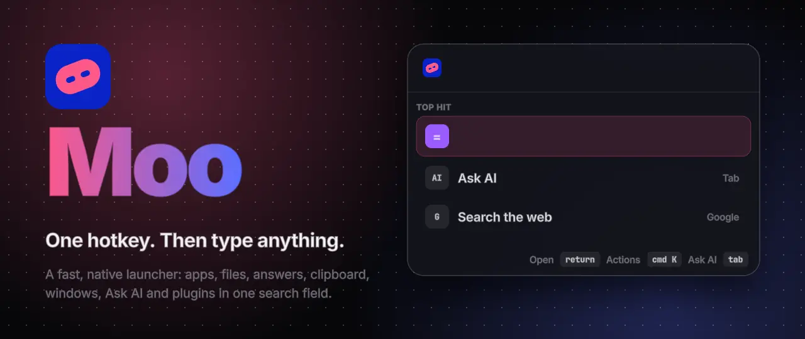
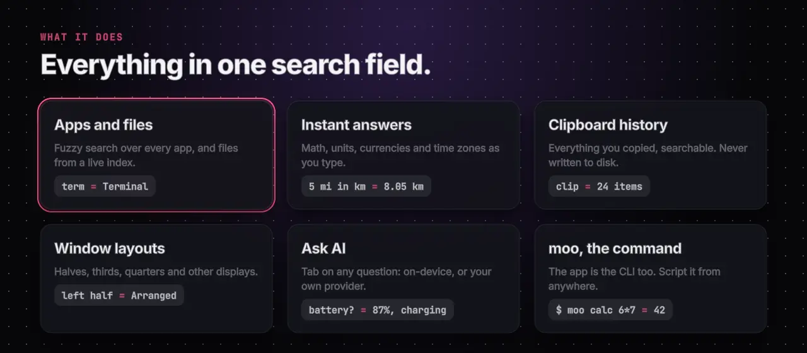
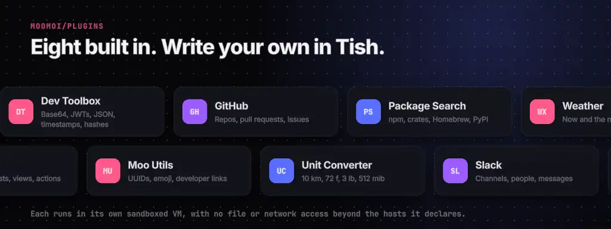
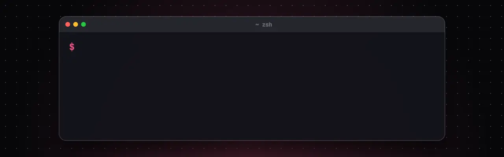

<div align="center">

<a href="https://moo.moi"></a>

**[Download for Mac](https://github.com/moomoi/moo/releases/latest/download/Moo-macos-universal.dmg)** ·
**[moo.moi](https://moo.moi)** ·
**[Docs](https://moo.moi/docs)** ·
**[Marketplace](https://moo.moi/marketplace)** ·
**[Write a plugin](https://moo.moi/docs/first-plugin)**

</div>

<br>

**Moo** is a keyboard launcher. Press one hotkey and type: apps, files, the clipboard, math and
conversions, window layouts, system commands, Ask AI and plugins all answer from one search field.
It's a single native process built with [Tish](https://github.com/tishlang/tish), with no webviews,
no Electron and no JavaScript, so it opens instantly and stays out of the way. On macOS and Windows.



## 🧩 Plugins

<a href="https://github.com/moomoi/plugins"></a>

Eight plugins ship with Moo, and you can write your own in Tish. Each runs in its own sandboxed VM,
with no file or network access beyond the hosts it declares. Their source, the plugin SDK and the
`@moo/ui` view toolkit are in **[moomoi/plugins](https://github.com/moomoi/plugins)**; the
**[marketplace](https://moo.moi/marketplace)** has them all, and
**[Write a plugin](https://moo.moi/docs/first-plugin)** takes you from nothing to a working command.

## 🐮 Get Moo



```sh
brew install moomoi/moo/moo
```

Or **[download the Mac app](https://github.com/moomoi/moo/releases/latest/download/Moo-macos-universal.dmg)**
(signed and notarized, Apple silicon and Intel). For Windows, get the zip from the
**[latest release](https://github.com/moomoi/moo/releases)**. New to Moo? Start with
**[Getting started](https://moo.moi/docs/install)**.

## 📦 Repositories

| | |
| --- | --- |
| **[moo](https://github.com/moomoi/moo)** | The app: source, releases and developer docs |
| **[plugins](https://github.com/moomoi/plugins)** | The official plugins, the plugin SDK and `@moo/ui` |
| **[homebrew-moo](https://github.com/moomoi/homebrew-moo)** | The Homebrew tap |

<br>

<sub>No analytics, no telemetry: your searches, clipboard and settings stay on your computer. The
animations here are made with [PopCraft](https://popcraft.app); their source is in
[popcraft/](https://github.com/moomoi/.github/tree/main/popcraft).</sub>
